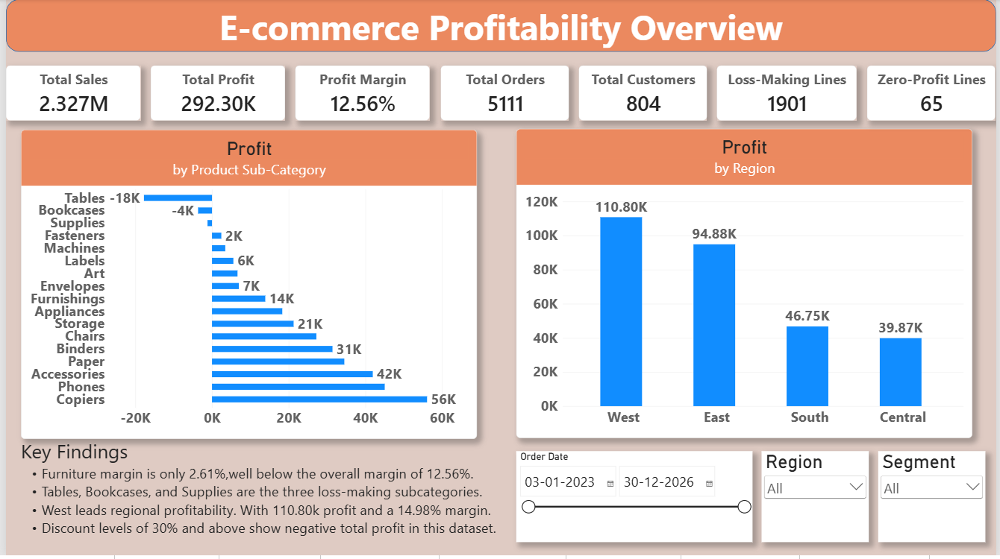
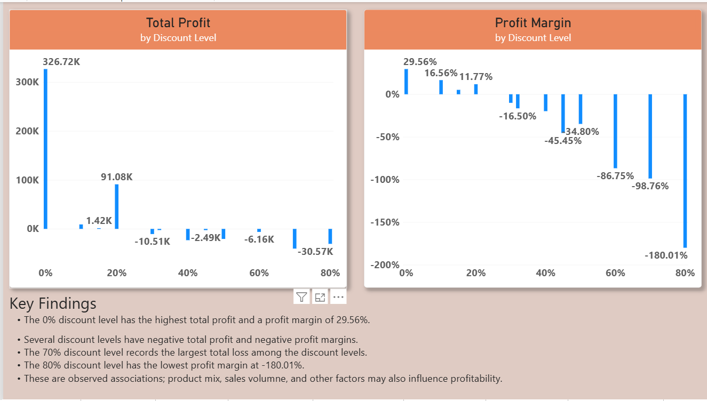
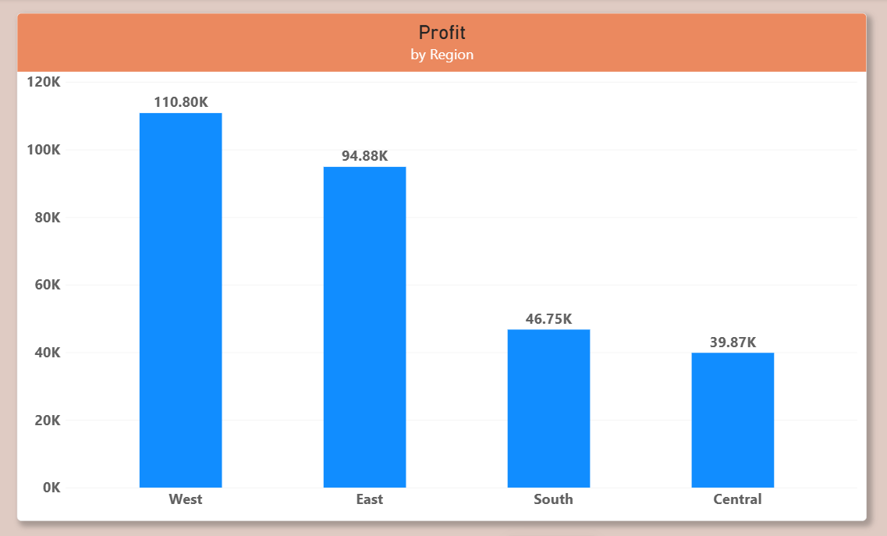
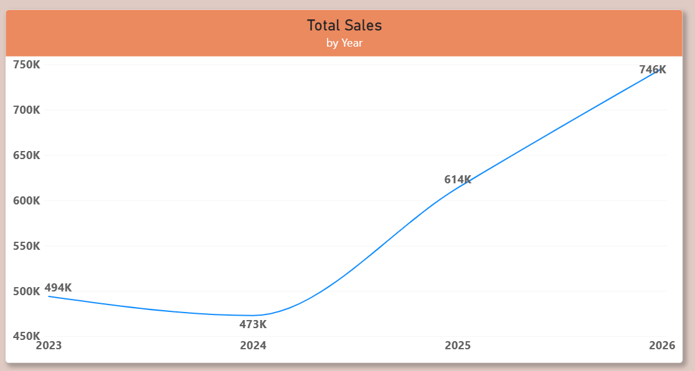

# E-commerce Profitability Analysis

An end-to-end analytics portfolio project using **Microsoft Excel 2019**
and **Power BI** to investigate sales, profitability, discount patterns,
and regional performance.

## Business question

**Where is the company making and losing money?**

## Headline KPIs

  KPI                               Result
  ------------------------- --------------
  Total sales                 2,326,534.35
  Total profit                  292,296.81
  Profit margin                     12.56%
  Distinct orders                    5,111
  Distinct customers                   804
  Order-line rows                   10,194
  Loss-making order lines            1,901
  Zero-profit order lines               65

## Tools

-   **Excel 2019:** data profiling, quality checks, PivotTables,
    exploratory analysis.
-   **Power BI:** data model, KPI cards, charts, matrix drill-downs,
    slicers, interactive reporting.

## Key findings

-   **Technology** generated the highest category profit: 146,543.38,
    with a 17.45% margin.
-   **Furniture** had a 2.61% margin, below the overall 12.56%.
-   **Tables, Bookcases, and Supplies** were the three loss-making
    sub-categories, with combined profit of -22,556.67.
-   **West** led regional profitability with 110,798.82 profit and a
    14.98% margin.
-   **Central** had the lowest regional margin at 7.92%.
-   **Consumer** generated the highest segment sales and profit; **Home
    Office** had the highest segment margin at 14.02%.
-   Discount levels of 30% and above recorded negative total profit in
    this dataset. The 70% discount level had the largest total loss
    (-40,300.57); the 80% level had the lowest margin (-180.01%).
-   Sales and profit reached their highest recorded values in 2026,
    while margin declined from 13.46% in 2025 to 12.87% in 2026.

> Discount patterns are observational associations, not proof that
> discounting alone caused losses. Product mix, sales volume, geography,
> and other factors may influence profitability.

## Data preparation

The project reviewed missing values, duplicate order lines, numerical
ranges, date validity, categorical consistency, discounts, quantities,
and postal-code formatting. A helper field, `Postal Code Corrected`,
adds a leading zero to four-character US postal codes while preserving
the original field and retaining Canadian alphanumeric codes. This
standardizes formatting but does not independently validate postal
codes.

The working Orders table has 10,194 rows; People has 4 rows; Returns has
296 rows. Each Orders row represents an order line, not a unique order.
Returns should not be merged into the order-line table without checking
relationship cardinality.

## Dashboard screenshots

## Files

-   `Ecommerce_Profitability_Project_Report.pdf` --- detailed
    methodology, findings, recommendations, and limitations.
-   `screenshots/` --- selected Power BI report screenshots.

## Limitations

-   Exact source dataset filename/version and download date were not
    recorded; add these if recoverable.
-   The analysis notes do not document a separate shipping-cost field.
-   Discount patterns do not prove causality.
-   The recorded date range ends on 30 December 2026; this does not
    prove complete calendar-year coverage.
-   Some matrix screenshots are clipped; detailed figures in the report
    are based on recorded analysis notes.

## Recommendations

1.  Investigate Tables, Bookcases, and Supplies for pricing, discount,
    cost, and product-mix factors.
2.  Prioritize Furniture profitability, especially Tables and Bookcases.
3.  Examine high-discount transactions and Central Furnishings at 60%
    discount.
4.  Compare product mix and discount distributions across regions.
5.  Track profit margin alongside sales growth.
6.  Document the exact source, KPI definitions, and refresh steps.
